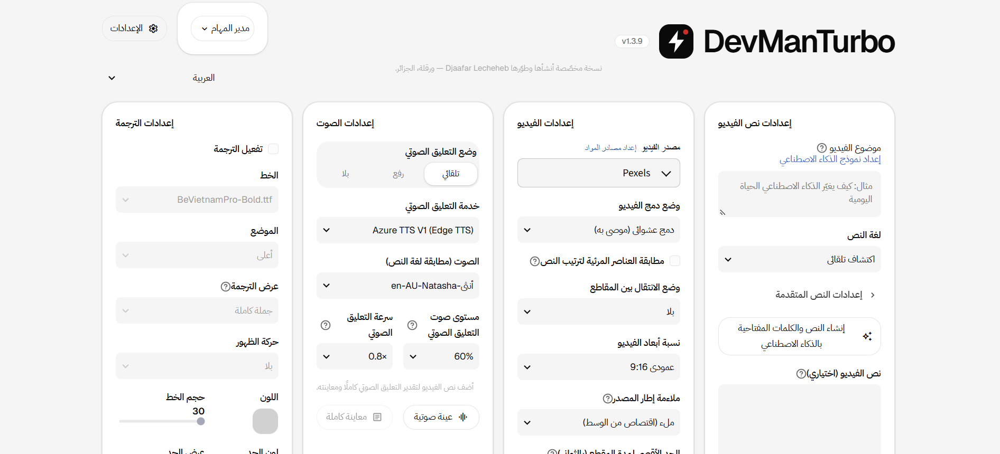
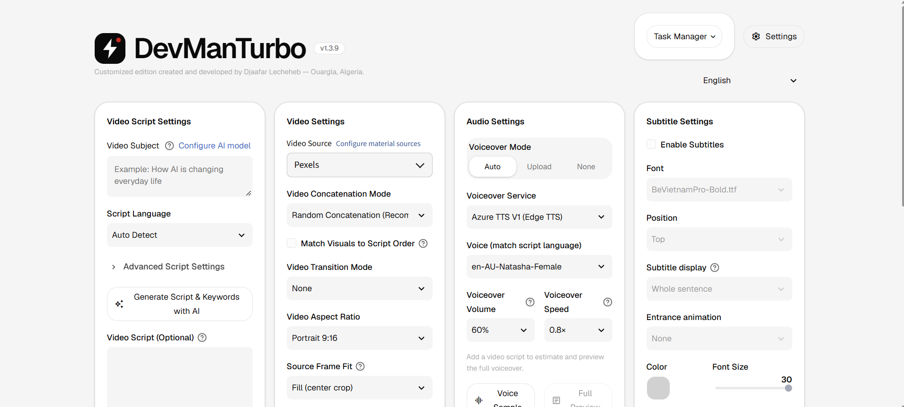
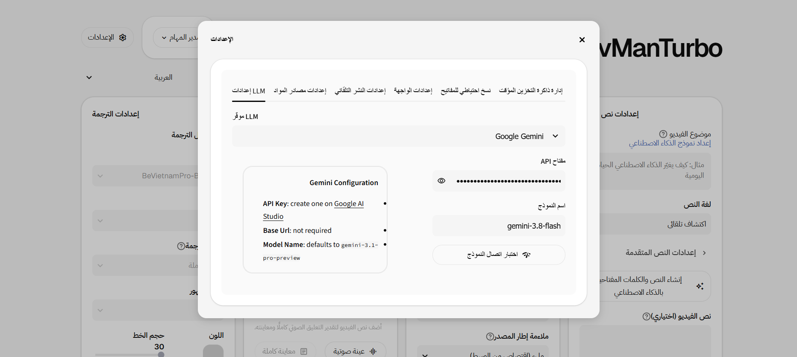

<div align="center" dir="rtl">


# DevManTurbo

**حوّل فكرة واحدة إلى فيديو قصير جاهز: نص وصوت ومقاطع وترجمة وموسيقى.**
نسخة معدّلة بواجهة عربية وتصميم احترافي من مشروع [MoneyPrinterTurbo](https://github.com/harry0703/MoneyPrinterTurbo).

العربية · [English](README.md)

</div>

<p align="center">
  
  
</p>

<div dir="rtl">

## لماذا هذه النسخة؟

مشروع MoneyPrinterTurbo محرّك قوي، لكن واجهته مصمّمة للناطقين بالصينية أولاً. أبقى DevManTurbo على هذا المحرّك وأضاف ما كان ينقص صنّاع المحتوى العرب والعالميين: واجهة عربية كاملة من اليمين إلى اليسار، وتصميم احترافي، ولغات أكثر، وإصلاحات ظهرت مع الاستخدام اليومي.

## المقارنة مع المشروع الأصلي

| الجانب | MoneyPrinterTurbo الأصلي | DevManTurbo |
|---|---|---|
| دعم العربية | غير متوفر | واجهة عربية كاملة بتخطيط من اليمين إلى اليسار (616 نصاً مترجماً) |
| لغات الواجهة | الصينية والإنجليزية وبعض اللغات | **15 لغة**: العربية، الأذرية، الكتالونية، الألمانية، الإنجليزية، الإسبانية، الفرنسية، الإندونيسية، الإيطالية، الكورية، البرتغالية، الروسية، التركية، الفيتنامية، الصينية |
| التصميم | شكل Streamlit الافتراضي | نظام تصميم فاتح مخصّص: بطاقات 24px، وعناصر تحكم 18px، وحدود رفيعة، ولون أحمر واحد للتمييز، وخطا Geist وIBM Plex Sans Arabic |
| الهوية | MoneyPrinterTurbo | شعار وأيقونة وترويسة جديدة |
| الترجمة العربية داخل الفيديو | تحتاج خطاً يدوياً | خط يدعم العربية مرفق في `resource/fonts` |
| الخطوط دون إنترنت | غير مطبّق | الخطوط مضمّنة، فتعمل الواجهة بلا إنترنت |
| الصفحة المستقلة | صفحة نصية بسيطة | واجهة HTML/CSS/JS كاملة يقدّمها الـ API على `/` |
| المحرّك والمزوّدون والـ API | الأصلي | متوافق مع الأصلي |

> كل ما في المحرّك (مزوّدو النماذج، ومصادر المقاطع، والتحويل الصوتي، والترجمة، والموسيقى، والـ API وسطر الأوامر) مصدره المشروع الأصلي ولا يزال متاحاً هنا. القائمة الكاملة في [README الأصلي](https://github.com/harry0703/MoneyPrinterTurbo).

## ما الذي أُضيف وحُسّن

- **العربية من الألف إلى الياء.** ترجمة كاملة، وتخطيط من اليمين إلى اليسار، وأصوات عربية في قائمة الأصوات.
- **15 لغة للواجهة** تُبدَّل من الشريط العلوي.
- **واجهة جديدة احترافية.** بطاقات وأزرار وحقول ونوافذ وتبويبات وتنبيهات موحّدة في كل الصفحات، ومنها نافذة الإعدادات.
- **إصلاحات وتحسينات** ظهرت مع الاستخدام اليومي. <!-- TODO: اكتب كل إصلاح في سطر -->
- **إضافات خاصة.** <!-- TODO: اكتب إضافاتك هنا -->

<p align="center">
  
</p>

## البدء السريع

```bash
git clone https://github.com/LechehebDjaafar/DevManTurbo.git
cd DevManTurbo
pip install -r requirements.txt
cp config.example.toml config.toml   # ثم أضف مفاتيح API
```

شغّل الواجهة (تُفتح على `http://127.0.0.1:8501`):

```bash
# ويندوز
webui.bat
# لينكس / ماك
sh webui.sh
```

شغّل الـ API (يقدّم الصفحة المستقلة على `http://127.0.0.1:8080`):

```bash
python main.py
```

شغّل من جذر المشروع حتى يُطبَّق الثيم في `.streamlit/config.toml`.

## هيكل المشروع (الجديد)

```
.streamlit/config.toml      الثيم الفاتح والألوان
webui/styles.css            طبقة نظام التصميم
webui/assets/               الخطوط والأيقونة
webui/i18n/                 ملفات اللغات الخمس عشرة
resource/public/            الواجهة المستقلة HTML/CSS/JS
resource/fonts/             خطوط الترجمة ومنها العربي
```

## الشكر والترخيص

بُني DevManTurbo على [MoneyPrinterTurbo](https://github.com/harry0703/MoneyPrinterTurbo) للمطوّر Harry والمساهمين فيه، بترخيص MIT. الشكر لهم على هذا الأساس. الإضافات في هذه النسخة أنشأها ويطوّرها **جعفر لشهب** من ورقلة، الجزائر.

إن أفادك DevManTurbo، فنجمة على المستودع تساعد غيرك على اكتشافه.

</div>
