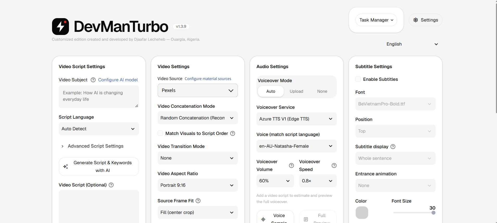
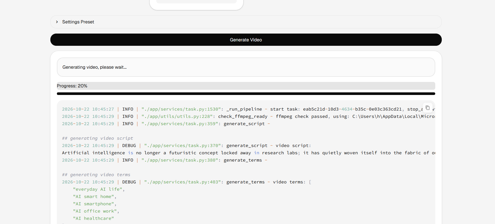
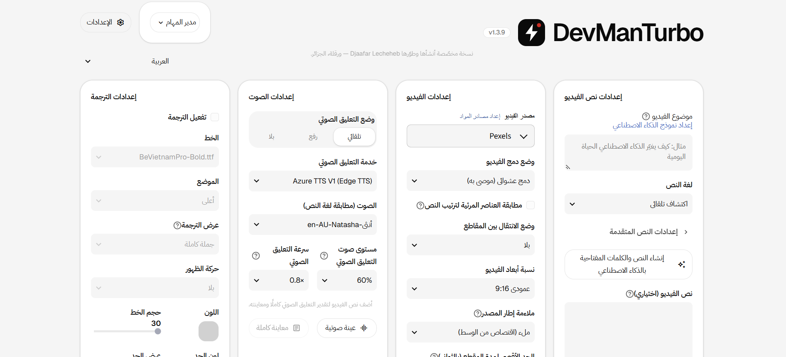
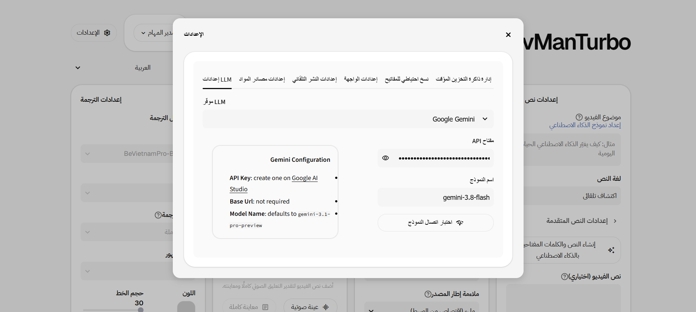

<div align="center">


# DevManTurbo

### One idea in, one ready-to-post short video out

Script, voiceover, footage, subtitles and music, all generated by AI from a fully Arabic-capable interface.

[](LICENSE)
[](#quick-start)
[](#supported-languages)
[](#)
[](https://github.com/LechehebDjaafar/DevManTurbo/stargazers)

[العربية](README.md) · **English**

<br>



</div>

## Why DevManTurbo?

Most AI video tools are English- or Chinese-only, paid, and weak on Arabic. **DevManTurbo** is open source, runs on your machine, and gives you:

- **A complete Arabic interface** with right-to-left layout, not a partial translation.
- **A professional design** using Geist and IBM Plex Sans Arabic.
- **15 UI languages**, switchable in one click.
- **Full control** of your keys, data and models.

> Built on the powerful [MoneyPrinterTurbo](https://github.com/harry0703/MoneyPrinterTurbo) engine (MIT), with everything Arabic-speaking creators were missing.

## How it works

1. **Type a topic**, for example "how AI is changing everyday life".
2. The model writes the **script** and extracts **keywords**.
3. The app fetches matching **footage** from Pexels, Pixabay or your files.
4. It generates the **voiceover** and subtitles, and adds **music**.
5. Everything is assembled into a **finished video** in 9:16, 16:9 or 1:1.

<div align="center">

<br><sub>Follow every generation stage live, with a detailed log.</sub>
</div>

## Screenshots

<div align="center">

| Arabic interface | English interface |
|:---:|:---:|
|  |  |


<br><sub>Settings: LLM provider, API keys, footage sources, auto-publish and backups.</sub>

</div>

## DevManTurbo vs. the original

| Area | Original MoneyPrinterTurbo | DevManTurbo |
|---|---|---|
| Arabic support | Not available | Full Arabic UI, right-to-left (616 translated strings) |
| UI languages | Chinese, English and a few others | **15 languages** |
| Design | Default Streamlit look | Custom light design system: 24px cards, 18px controls, hairline borders, one red accent |
| Branding | MoneyPrinterTurbo | New logo, favicon and header |
| Arabic subtitles in video | Needs a manual font | Arabic-capable font bundled |
| Fonts offline | n/a | Embedded, UI works without internet |
| Standalone page | Plain placeholder | Full HTML/CSS/JS front end served by the API |
| Engine, providers, API | Upstream | Compatible with upstream |

## What was added and improved

- **Arabic end to end:** full translation, RTL layout, Arabic voices.
- **15 interface languages.**
- **A unified new interface** across every page, dialog, tab and alert.
- **Fixes and refinements** found through daily use. <!-- TODO: list each fix -->
- **Extras specific to this fork.** <!-- TODO: list your extras -->

## Supported languages

العربية · English · Français · Español · Deutsch · Italiano · Português · Русский · Türkçe · Bahasa Indonesia · Tiếng Việt · 한국어 · Azərbaycan dili · Català · 简体中文

## Quick start

**Requirements:** Python 3.11+, FFmpeg, and an API key for an LLM provider (Gemini, OpenAI, DeepSeek, or a local model via Ollama).

```bash
git clone https://github.com/LechehebDjaafar/DevManTurbo.git
cd DevManTurbo
pip install -r requirements.txt
cp config.example.toml config.toml    # then add your keys
```

Web interface (opens at `http://127.0.0.1:8501`):

```bash
webui.bat        # Windows
sh webui.sh      # Linux / macOS
```

API (serves the standalone page at `http://127.0.0.1:8080`):

```bash
python main.py
```

> Run from the project root so the theme in `.streamlit/config.toml` is applied.

## FAQ

**Is it free?** Yes, it is open source. Some providers need API keys, and many offer a free tier.

**Does it work offline?** The interface does. Script generation and footage fetching need a connection, unless you use a local model and your own files.

**Do Arabic subtitles render correctly?** Yes. Pick an Arabic-capable font such as `IBMPlexSansArabic-Bold.ttf`.

## Roadmap

- [ ] A short demo video at the top of this page
- [ ] More Arabic voices and dialects
- [ ] Ready-made subtitle styles and transitions
- [ ] <!-- TODO: your next goals -->

## Contributing

Contributions are welcome: report a bug in [Issues](https://github.com/LechehebDjaafar/DevManTurbo/issues), send a pull request, or improve a translation in `webui/i18n/`.

## Star history

<a href="https://star-history.com/#LechehebDjaafar/DevManTurbo&Date">
  
</a>

## Credits and license

Built on [MoneyPrinterTurbo](https://github.com/harry0703/MoneyPrinterTurbo) by Harry and contributors, under the MIT license. Additions in this fork were created and are maintained by **Djaafar Lecheheb** from Ouargla, Algeria.

<div align="center">

**If this project helps you, please ⭐ the repo. It is the simplest way to support it.**

</div>
